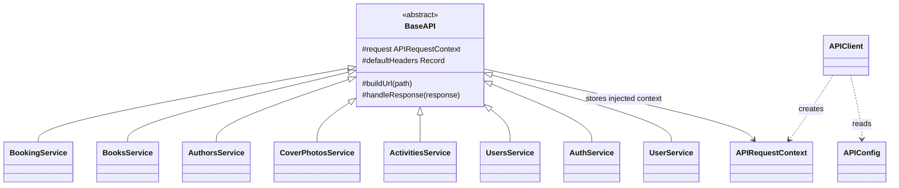
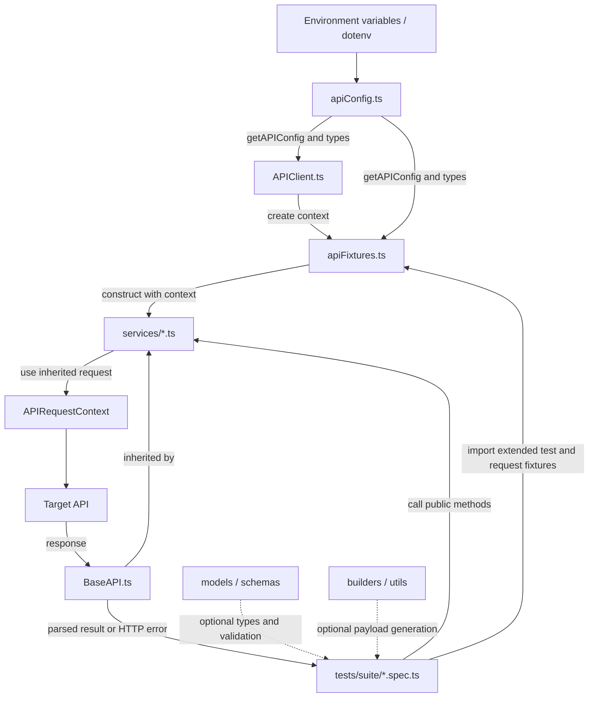
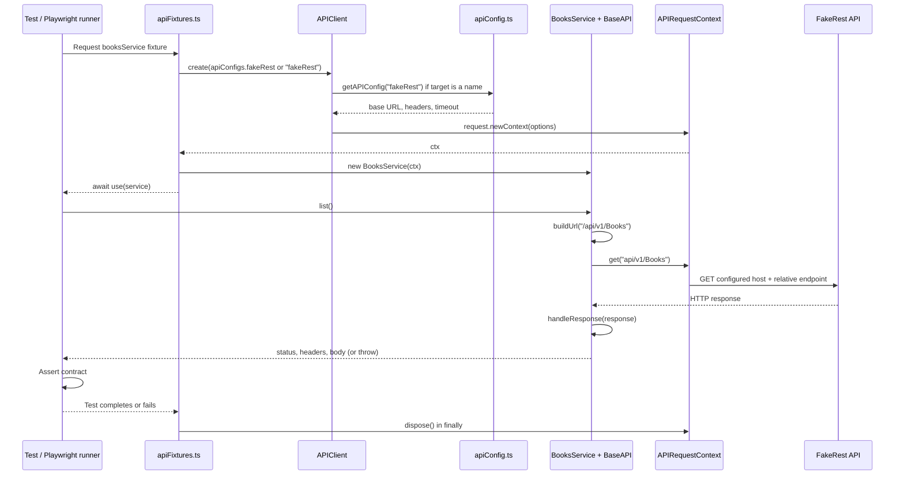

# API Test Architecture & Conventions

Purpose

- Provide a canonical reference for agents to create API tests under `./api/`.
- Enforce a consistent file structure, naming, metadata and test template so generated API tests are uniform and machine-readable.

## Folder structure and responsibilities

All API tests live under `api/`. The existing layout is:

```text
api/
├── APIClient.ts                 Creates configured Playwright request contexts
├── base/BaseAPI.ts             Shared service behavior
├── config/
│   ├── apiConfig.ts            Named hosts, headers, timeouts, credential settings
│   └── framework.playwright.config.ts  Offline framework test runner
├── fixtures/apiFixtures.ts     Creates/injects services and disposes contexts
├── services/                   Resource endpoints (BooksService, BookingService, ...)
├── models/                     TypeScript DTOs and enums
│   └── schemas/                JSON response/request schemas
├── builders/                   Fluent request-payload builders
├── utils/                      Data generation, validation, logging, retry helpers
├── tests/
│   ├── booker/                 Restful-Booker endpoint tests
│   ├── fakerest/               FakeRest endpoint and contract tests
│   └── framework/              Local routing and assertion regression tests
├── api-ui.spec.ts              Generic API-to-UI integration example
└── api_test_architecture.md    This guide
```

| Folder/file | Owns | Does not own |
| --- | --- | --- |
| [config](./config/) | Target registration and environment settings | Resource URLs or test assertions |
| [APIClient.ts](./APIClient.ts) | Request context creation | Business operations |
| [base](./base/) | Relative endpoint handling and common response/error handling | Per-API host selection |
| [services](./services/) | Endpoint paths, HTTP verbs, request payloads | Fixture lifecycle or test pass/fail assertions |
| [fixtures](./fixtures/) | Dependency wiring, context setup/teardown | Endpoint implementations |
| [models](./models/) | Payload/response types and schemas | Sending requests |
| [builders](./builders/) | Constructing reusable payloads | HTTP calls or inheritance from services |
| [utils](./utils/) | Shared utilities | Automatically running retries or authentication |
| [tests](./tests/) | Scenarios, expected results, negative cases | Hardcoded hosts or duplicated clients |

`fixtures/` contains executable Playwright fixtures, not static data. For future static JSON payloads, create a clearly named `test-data/` folder only when needed. There is currently no `api/helpers/` or `api/support/fixtures/` folder.

## Inheritance versus imports and dependency injection

Only the **service classes inherit from `BaseAPI`**. Configuration, client creation, fixture wiring, and test usage are separate relationships.



- `extends BaseAPI`: a service inherits protected helpers and the stored request context. `super(request)` initializes that context in the base constructor.
- `import`: makes an exported class, function, or type available to another module; it does **not** create inheritance.
- `new BooksService(ctx)`: injects an already-configured context into the service. The service does not create or dispose it.
- `base.extend<Fixtures>(...)`: extends Playwright's **test fixture set**, not the `BaseAPI` class. The name `base` here is an alias for Playwright's imported `test` function.
- `UserBuilder` and `ComplexUserBuilder` are independent payload-building classes. The latter does not inherit from the former. Their `.build()` results may be passed to compatible service methods.
- DTO interfaces are compile-time types, not runtime response validation; tests must still assert fields or validate schemas.

Do not confuse [UserService.ts](./services/UserService.ts) (`/users`, generic application) with [UsersService.ts](./services/UsersService.ts) (`/api/v1/Users`, FakeRest).

### Canonical Books service

[BooksService.ts](./services/BooksService.ts), exposed through `booksService`, owns all FakeRest Books operations. The duplicate `FakeRestService` class and `fakeRestService` fixture have been removed after migrating their repository consumers. The named target `fakeRest` and request fixture `fakeRestApiRequest` remain unchanged.

| Former method | Canonical method |
| --- | --- |
| `listBooks()` | `list()` |
| `createBook(payload)` | `create(payload)` |
| `getBook(id)` | `getById(id)` |
| `updateBook(id, payload)` | `update(id, payload)` |
| `deleteBook(id)` | `delete(id)` |

Migrated callers now use the existing Books service's write convention: serialized JSON with `Content-Type: application/json; v=1.0`. Request paths, payload fields, response parsing, and HTTP-error behavior are unchanged. Local routing regressions verify both POST and PUT headers/bodies; live Books tests retain all six former wrapper scenarios, including malformed input and boundary values. This consolidation removes duplicate implementation, not test coverage.

## Dependency and execution workflow

### How modules connect



Config-to-fixture imports serve the generic `apiConfig` fixture and option types. Named contexts such as `fakeRestApiRequest` normally pass the target name to `APIClient.create`, which resolves its configuration. They do not use the generic default hostname.

### Example: a test requests `booksService`



1. The root [playwright.config.ts](../playwright.config.ts) discovers API specs through the `api` project.
2. A spec imports `test` and `expect` from [apiFixtures.ts](./fixtures/apiFixtures.ts), not directly from Playwright when it needs custom fixtures.
3. Destructuring `booksService` causes Playwright to set up its dependency, `fakeRestApiRequest`. Unrequested service fixtures are not created.
4. `APIClient` creates a context using the selected API's host, headers, and timeout. The fixture may override the complete config through `apiConfigs`.
5. The fixture constructs `BooksService(ctx)`. Its constructor calls `super(ctx)`.
6. A service method supplies its relative resource path and HTTP verb. `BaseAPI.buildUrl` strips the leading slash; the context resolves the final URL.
7. `BaseAPI.handleResponse` reads status/headers, parses JSON when possible, and returns `{ status, headers, body }`. HTTP statuses of 400 or above throw an error with `.status` and `.body`.
8. The test verifies the result. Negative tests assert the thrown error; raw-context tests receive a Playwright `APIResponse` instead.
9. After the test, the owning request fixture disposes its context in `finally`, including when the test fails.

All these request fixtures are test-scoped. Within one test, FakeRest services share `fakeRestApiRequest`; Booking has a separate context. Across tests, contexts are isolated. `authService` uses generic `apiRequest`; it is not automatically FakeRest or Booking authentication. The current generic `authToken` fixture catches login failures and yields `undefined`, so authentication-dependent tests must explicitly verify successful authentication.

## Scaling: where to make changes

| Requirement | Changes needed |
| --- | --- |
| Another scenario for an existing service | Add a spec/case under its suite; reuse existing fixtures |
| Another endpoint on an existing resource | Add a service method and its tests; no new host/context |
| Another resource on the same API host | Add a service extending `BaseAPI`; wire it to the existing named context; add tests |
| Another API host | Register a target, add its service and named context fixture, add tests and routing regression |
| Another environment | Supply environment-specific host/credential variables; do not duplicate service classes |
| Another payload shape | Add DTO/schema and optional builder; do not put HTTP behavior in the builder |

### A. Add a test using an existing service

For example, a new spec under `api/tests/fakerest/` can reuse the current Books fixture without changing config or creating a context:

```typescript
import { test, expect } from "../../fixtures/apiFixtures";

test("Books: seeded book has an ID and title", async ({ booksService }) => {
  const result = await booksService!.getById(1);
  expect(result.status).toBe(200);
  expect(result.body).toMatchObject({
    id: 1,
    title: expect.any(String),
  });
});
```

The non-null assertion `!` is necessary here because existing service fixture types are optional. For new fixtures, prefer a required type when the fixture always supplies an instance. Add the metadata header described below to new specs.

### B. Add a resource on an existing host

1. Add a service in `services/` with the same pattern as [BooksService.ts](./services/BooksService.ts): inherit `BaseAPI`, accept `APIRequestContext`, and call `super(request)`.
2. Add methods using `this.buildUrl(relativePath)`, `this.request.get/post/...`, and `this.handleResponse(response)`.
3. Add its type to `Fixtures` in [apiFixtures.ts](./fixtures/apiFixtures.ts).
4. Add a fixture that depends on the appropriate existing context, constructs the service, and passes it to `use`.
5. Add specs using that service fixture. There is no new target registration if the host is unchanged.

### C. Add a new API host end to end

The following is an **illustrative Orders API**, not an endpoint already available in this repository. Replace its host, paths, schema, and expected statuses with the real API contract.

**1. Register a target** inside `API_TARGETS` in [apiConfig.ts](./config/apiConfig.ts):

```typescript
orders: {
  prefix: "ORDERS_API",
  baseUrl: "https://orders.example.test",
},
```

Supply `ORDERS_API_BASE_URL` in the environment for the actual host. `APIName` automatically includes `orders`; no manual union change is needed.

**2. Create `api/services/OrdersService.ts`:**

```typescript
import { APIRequestContext } from "@playwright/test";
import { BaseAPI } from "../base/BaseAPI";

export class OrdersService extends BaseAPI {
  constructor(request: APIRequestContext) {
    super(request);
  }

  async getById(id: number) {
    const response = await this.request.get(this.buildUrl(`/orders/${id}`));
    return this.handleResponse(response);
  }
}
```

**3. Extend the existing fixture type and fixture object** in [apiFixtures.ts](./fixtures/apiFixtures.ts). Add these members alongside the current ones; do not replace the existing fixture set:

```typescript
// Add inside type Fixtures:
ordersApiRequest: APIRequestContext;
ordersService: import("../services/OrdersService").OrdersService;
```

```typescript
// Add inside base.extend<Fixtures>({...}):
ordersApiRequest: async ({ apiConfigs }, use) => {
  const ctx = await APIClient.create(apiConfigs.orders ?? "orders");
  try {
    await use(ctx);
  } finally {
    await ctx.dispose();
  }
},

ordersService: async ({ ordersApiRequest }, use) => {
  const { OrdersService } = await import("../services/OrdersService.js");
  await use(new OrdersService(ordersApiRequest));
},
```

**4. Add tests** under `api/tests/orders/`. Import the extended test fixture, request `ordersService`, and verify the real API's response. Provision test data explicitly rather than assuming any particular ID exists. The root `api` project's existing test pattern already includes the new directory.

**5. Verify isolation and behavior.** Add local routing coverage to [api-routing.spec.ts](./tests/framework/api-routing.spec.ts), then run the new suite against its authorized test environment:

```powershell
npx playwright test --config=api\config\framework.playwright.config.ts
npx playwright test --config=playwright.config.ts --project=api 'api[\\/]tests[\\/]orders'
```

The standard project run invokes repository global setup/teardown. Shared cleanup archives previous Allure results and resets AI artifacts once, while Playwright owns test output cleanup. See [cleanup ownership and retention](../ai/failure-summaries/README.md#cleanup-ownership-and-retention). The framework runner uses local fixtures; its cleanup regressions target temporary repositories rather than real report directories. Run `npm run test:framework` to build the reporter before exercising the full framework suite.

### Guardrails for new suites

- Keep hosts in config, endpoints in services, dependency lifecycle in fixtures, and business expectations in tests.
- A new service extending `BaseAPI` does not automatically select a host: its injected request context determines routing.
- Never weaken a failing assertion until the expected contract is established. Test persistent CRUD only against APIs that actually persist writes; FakeRest requires non-persistent endpoint checks.
- Do not add retries, accepted error statuses, or skipped tests merely to obtain a passing run.
- Configure/authenticate each API separately. A credential value in config is not automatically applied as a header or login token.
- Use existing builders, DTOs, schemas, and utilities where their payload contracts match; they are optional dependencies, not mandatory inheritance layers.

File naming conventions

- Use kebab-case for files and folders.
- Prefix test files with date (YYYYMMDD) when the test is created by an agent, then a concise title: `20261001-create-user.spec.ts`.
- Test file extension: `.spec.ts` (Playwright TypeScript) — agents should follow the repo's test framework.

Test metadata header (top of each test file)

- Every generated test file must start with a JSON metadata block in a comment so agents and tooling can parse it. Example:

/*
{
  "id": "api-user-001",
  "suite": "user",
  "title": "Create user with valid payload",
  "priority": "P1",
  "tags": ["smoke","user","api"],
  "author": "agent/<agent-name>",
  "created": "2026-10-01"
}
*/

- Required fields: `id`, `suite`, `title`, `priority`, `tags`.
- Optional: `owner`, `description`, `relatedTicket`, `contracts` (list of schema ids to validate against).

## Multiple API hosts and automatic endpoint routing

Use [apiFixtures.ts](./fixtures/apiFixtures.ts) and [APIClient.ts](./APIClient.ts), not hardcoded hostnames. Each service fixture receives its own API's request context automatically, so Booking and FakeRest suites can run together or in parallel without changing environment variables between tests.

| API target | Host variable | Default host | Service fixtures |
| --- | --- | --- | --- |
| `booking` | `BOOKING_API_BASE_URL` | `https://restful-booker.herokuapp.com` | `bookingService` |
| `fakeRest` | `FAKEREST_API_BASE_URL` | `https://fakerestapi.azurewebsites.net` | `booksService`, `authorsService`, `coverPhotosService`, `activitiesService`, `usersService` |
| `default` | `API_BASE_URL` | `https://api.dev.example.com` | Generic `apiRequest`, `authService`, API/UI integration |

Set these variables in the ignored root `.env` file or your CI environment. `NODE_ENV` remains environment metadata; supply the appropriate host variables for each environment. It does not discover hostnames or select an environment file.

- Named targets **do not fall back to `API_BASE_URL`**. Migrate an existing Booking-only configuration to `BOOKING_API_BASE_URL`, or a FakeRest-only configuration to `FAKEREST_API_BASE_URL`.
- Credentials are scoped too: `BOOKING_API_KEY`, `BOOKING_API_USER`, `BOOKING_API_PASS`, and the equivalent `FAKEREST_API_*` variables. Generic `API_KEY`, `API_USER`, and `API_PASS` apply only to `default`. These are available in the configuration; authentication remains API-specific and keys are not automatically sent in an assumed header.
- Per-target `*_TIMEOUT_MS` and `*_RETRY_ATTEMPTS` override the generic settings. The retry configuration remains metadata for retry helpers; the client does not automatically retry requests.
- Request contexts own default headers and cookies and are disposed after each test. Do not mutate shared configuration or `process.env` inside tests.
- Configure a host plus optional gateway prefix, such as `https://gateway.example.test/booking-service`. [BaseAPI.ts](./base/BaseAPI.ts) resolves `/booking/123` as `https://gateway.example.test/booking-service/booking/123`. Trailing slashes are normalized automatically.
- Service resource/version paths remain relative in service classes (for example `/api/v1/Books`). Do not repeat these paths in the configured gateway prefix. Changing hosts does not infer changes to an API's resource names or version.
- Direct context calls must use relative paths **without a leading slash** to preserve a gateway prefix. Built-in Playwright `request` and the project's generic `apiRequest` are different fixtures; use the latter for named routing.

For a raw-request suite, explicitly select the target once:

```typescript
import { test, expect } from "../../fixtures/apiFixtures";

test.use({ apiTarget: "fakeRest" });

test("lists books", async ({ apiRequest }) => {
  const response = await apiRequest.get("api/v1/Books");
  expect(response.status()).toBe(200);
});
```

A test can use `bookingService` and `booksService` together without `test.use`. For direct context access, use `bookingApiRequest` and `fakeRestApiRequest`. `apiTarget` only selects the generic `apiRequest`/`apiConfig`; it never redirects named service fixtures.

When adding an API:

1. Register its name, environment-variable prefix, and default host in `API_TARGETS` in [apiConfig.ts](./config/apiConfig.ts). `APIName` updates automatically.
2. Reuse `apiRequest` with `test.use({ apiTarget: "newTarget" })`, or wire a dedicated request fixture to `APIClient.create("newTarget")` and inject it into the new service.
3. Extend `BaseAPI` and keep endpoint paths relative. Do not construct URLs with `process.env`, embed hostnames, or change the shared `api` project's hostname to switch services.
4. Add a local routing regression to [api-routing.spec.ts](./tests/framework/api-routing.spec.ts). Tests may override the `apiConfigs` fixture with complete per-target configurations; no global environment mutation is needed.

`APIClient.create()` and `API_CONFIG` retain the generic default configuration for legacy callers. Manually created contexts must be disposed in `finally` blocks. Custom configurations passed to `APIClient.create(config)` receive the same base-URL validation and normalization as named targets.

Run the offline regression suite (local servers only; no browser or public API required):

```powershell
npx playwright test --config=api\config\framework.playwright.config.ts
```

Test template (Playwright + request)

- Use the project's `apiRequest` fixture or named service fixtures.
- Follow this scaffold so tools and reporters can parse intent.

```typescript
import { test, expect } from '../../fixtures/apiFixtures';
import Ajv from 'ajv';
import userSchema from '../../models/schemas/user.schema.json';

const ajv = new Ajv();

/*
METADATA JSON BLOCK
*/

test.describe('user - Create', () => {
  test('Create user with valid payload', async ({ apiRequest }) => {
    // Arrange
    const payload = {
      name: 'Jane Doe',
      email: `jane.${Date.now()}@example.com`,
      password: 'P@ssw0rd'
    };

    // Act
    const resp = await apiRequest.post('users', { data: payload });

    // Assert
    expect(resp.status()).toBe(201);
    const body = await resp.json();
    const valid = ajv.validate(userSchema, body);
    expect(valid).toBeTruthy();
  });
});
```

Selectors and stability (API-specific)

- Prefer explicit contract/schema validation (AJV or equivalent) over brittle body-field assertions alone.
- Centralize JSON schemas under `api/models/schemas` and DTOs under `api/models`.

Test data and fixtures

- Keep executable Playwright fixtures in [api/fixtures](./fixtures/). Use [builders](./builders/) and [utils](./utils/) for generated payloads; add static JSON under `api/test-data/` if needed.
- For sensitive credentials, use environment variables and CI secret stores.
- Keep example request/response payloads as `.json` fixtures when helpful.

Retries, timeouts and flakiness

- Use HTTP status + schema checks as primary assertions.
- For eventually-consistent endpoints, use or extend [api/utils/retry.ts](./utils/retry.ts) rather than adding fixed sleeps. A configured retry count does not automatically retry service calls.

Reporting and attachments

- Capture raw request/response bodies on failure and attach them to the test report.
- Include request ID or correlation IDs when available.

Code style and linting

- Follow TypeScript, Prettier, and ESLint project conventions.
- Avoid duplicating HTTP client logic inside tests; reuse [APIClient.ts](./APIClient.ts) through [apiFixtures.ts](./fixtures/apiFixtures.ts).

PR checklist for generated API tests

- Metadata block present and accurate.
- Uses JSON schema validation for responses when available.
- No secrets hardcoded.
- Test runs locally via `npx playwright test <file>` and passes against the target environment.

Generator guidelines for agents (how to use this file)

- Always create the metadata JSON block first.
- Use the named service fixture for the target API. For new APIs, follow the registration steps above before generating tests; never embed a hostname in a test or service endpoint.
- Place the test in `api/tests/<suite>/` and name it following the naming convention.
- Add or reuse JSON schemas under `api/models/schemas` and reference them in `contracts` metadata when applicable.
- Reuse payload builders/utilities, or add static data under `api/test-data/` when needed and reference it by relative path. Register executable fixtures in [apiFixtures.ts](./fixtures/apiFixtures.ts).
- Run the test locally and capture results; if timing issues appear, add targeted retry helpers.

Example minimal generated file

```typescript
/*
{
  "id": "api-user-001",
  "suite": "user",
  "title": "Create user with valid payload",
  "priority": "P1",
  "tags": ["smoke","user","api"]
}
*/

import { test, expect } from '../../fixtures/apiFixtures';
import Ajv from 'ajv';
import userSchema from '../../models/schemas/user.schema.json';

const ajv = new Ajv();

test('Create user with valid payload', async ({ apiRequest }) => {
  const payload = { name: 'Agent User', email: `agent.${Date.now()}@example.com`, password: 'P@ssw0rd' };
  const resp = await apiRequest.post('users', { data: payload });
  expect(resp.status()).toBe(201);
  const body = await resp.json();
  expect(ajv.validate(userSchema, body)).toBeTruthy();
});
```

---

If you want agents to enforce additional rules (specific metadata fields, naming prefixes, or a different test runner), update this file and notify agents.
