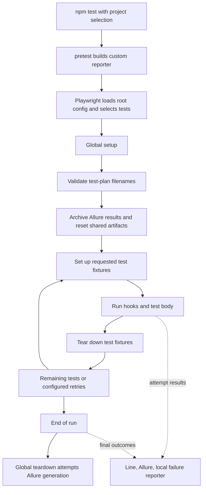
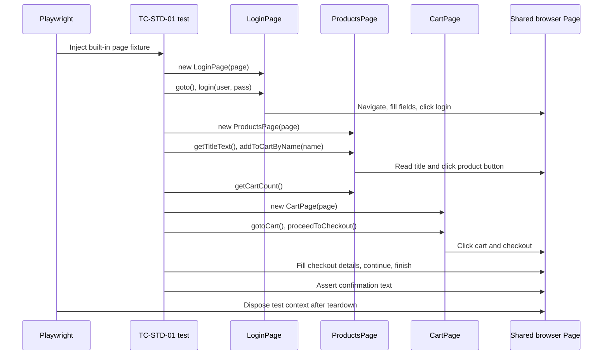
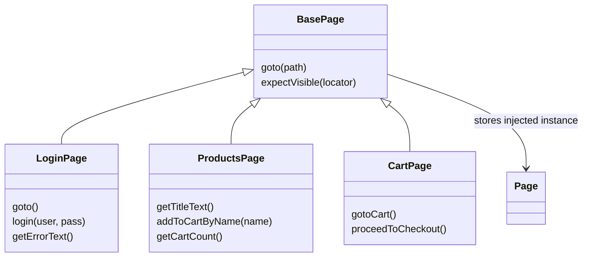
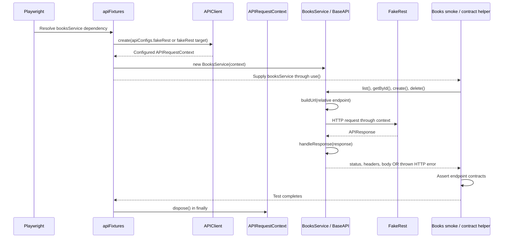

# Framework execution flow

Last verified against repository source: 2026-10-16.

This guide follows a test from its command to fixtures, classes, methods, assertions, and reports. It describes current behavior, not a proposed redesign. See [decision.md](decision.md) for important design choices and future change records.

## 1. Start here

| Question | Entry point |
| --- | --- |
| Which command runs? | [package.json](package.json): npm scripts |
| Which tests, browsers, and URLs are selected? | [playwright.config.ts](playwright.config.ts): projects and `testMatch` |
| What happens before tests? | [playwright-global-setup.ts](playwright-global-setup.ts): `globalSetup()` |
| How do UI tests use page objects? | [SauceDemo happy-path test](ui/tests/saucedemo/tc-std-01.spec.ts) |
| How do API tests receive services? | [apiFixtures.ts](api/fixtures/apiFixtures.ts): extended `test` |
| How are API responses interpreted? | [BaseAPI.ts](api/base/BaseAPI.ts): `handleResponse()` |
| Where are failure summaries described? | [Failure-summary guide](ai/failure-summaries/README.md) |

## 2. Run-level flow



The diagram separates test execution from reporter callbacks; reporters collect results throughout the run, not only after teardown.

1. `npm test` runs `pretest`, which invokes `build:ai` and compiles the local reporter with esbuild.
2. The root configuration selects tests using project-specific patterns. Eight UI projects cover six applications: TodoMVC and UI Testing Playground use Chromium and Firefox; the other four use Chromium. The ninth project is `api`.
3. Root global setup runs [validate-testplans.js](scripts/validate-testplans.js). Failure stops setup.
4. It delegates to [UI global setup](ui/support/global-setup/global-setup.ts), which calls `cleanRunArtifacts({ includeTestResults: false })` from [clean-ai.js](scripts/clean-ai.js). Playwright owns cleanup of configured test output directories.
5. Playwright supplies fixtures and runs test hooks/body. Requested custom fixtures may depend on other fixtures.
6. Fixture teardown releases resources. Root retries are `0` locally and `2` on CI; CI uses one worker, while local runs use Playwright's default worker count. `fullyParallel` is enabled.
7. [Global teardown](ui/support/global-teardown/global-teardown.ts) attempts Allure report generation. Generation errors are logged, not rethrown.

**Important:** A filtered root-config run still invokes the global hooks. Save needed reports before rerunning and avoid concurrent runs sharing output directories. Direct `npx playwright test` does not invoke npm's `pretest`; build the reporter first.

## 3. UI flow: one real checkout test

Source: [tc-std-01.spec.ts](ui/tests/saucedemo/tc-std-01.spec.ts).



### What each layer does

| Layer | Actual behavior in this example |
| --- | --- |
| [UI fixture exports](ui/support/fixtures/base.ts) | Re-export Playwright `test`, `expect`, and the `Page` type. No automatic login or page-object construction. |
| [Typed account data](ui/test-data/saucedemo/users.ts) | Supplies `usersByKey.standard` from the canonical validated dataset. |
| Test body | Creates page objects, selects a product, orchestrates checkout, and asserts observable results. |
| [LoginPage](ui/pages/saucedemo/LoginPage.ts) | Constructor stores locators. `goto()` delegates to `super.goto("/")`; `login()` fills username/password and clicks login. |
| [ProductsPage](ui/pages/saucedemo/ProductsPage.ts) | `getTitleText()` reads text; `addToCartByName()` clicks within a matching product; `getCartCount()` reads the badge. |
| [CartPage](ui/pages/saucedemo/CartPage.ts) | `gotoCart()` clicks the cart link; `proceedToCheckout()` clicks checkout. |
| [BasePage](ui/pages/common/BasePage.ts) | Stores the injected `Page`; provides `goto(path)` and `expectVisible(locator)`. |

All three page objects use the **same browser tab**, not three independent pages. Constructors define references/locators; actions occur when methods are called and awaited.

This particular test still performs checkout field interactions directly through `page`. A [CheckoutPage](ui/pages/saucedemo/checkout.page.ts) exists, but this scenario does not instantiate it. The guide deliberately preserves that distinction.

### Inheritance is not fixture injection



- `extends BasePage` means **inheritance**: common methods/state are reused.
- `new LoginPage(page)` means **dependency injection**: an existing browser object is supplied.
- `import` only makes a symbol available; it does not run login or create inheritance.
- `test.extend(...)` creates a **fixture set**, not a page subclass.
- OrangeHRM has a separate CommonJS page hierarchy and an optional authenticated fixture. Playground pages inherit through their own intermediate base. See the [UI architecture guide](ui/ui_test_architecture.md) for those variations.

## 4. API flow: one real Books test

Source: [books.smoke.spec.ts](api/tests/fakerest/books.smoke.spec.ts).



The final disposal is performed on the context returned by `APIClient.create`, not on the static client class.

### Dependency chain and method responsibilities

1. The spec requests `booksService` from [apiFixtures.ts](api/fixtures/apiFixtures.ts). Playwright resolves its dependency on `fakeRestApiRequest` and that fixture's `apiConfigs` option.
2. `fakeRestApiRequest` calls [APIClient.create()](api/APIClient.ts) with a per-test override if supplied, otherwise the named `fakeRest` target.
3. [getAPIConfig()](api/config/apiConfig.ts) resolves the named host/settings; `normalizeBaseUrl()` validates the URL and preserves optional gateway prefixes with a trailing slash.
4. `APIClient.create()` calls `request.newContext()` with the base URL, headers, and timeout. It does not launch a browser.
5. The service fixture constructs [BooksService](api/services/BooksService.ts) and exposes it with `await use(...)`. Its parent request fixture pauses until the test finishes, then disposes the context in `finally`.
6. `BooksService extends BaseAPI`; `super(request)` stores the supplied context. Service methods map to HTTP verbs:

   | Method | HTTP operation |
   | --- | --- |
   | `list()` | GET `api/v1/Books` |
   | `getById(id)` | GET `api/v1/Books/{id}` |
   | `create(data)` | POST `api/v1/Books`, serialized JSON payload |
   | `update(id, data)` | PUT `api/v1/Books/{id}`, serialized JSON payload |
   | `delete(id)` | DELETE `api/v1/Books/{id}` |

7. [BaseAPI.buildUrl()](api/base/BaseAPI.ts) strips leading slashes and rejects absolute/foreign-host endpoint forms. The request context resolves the relative endpoint against its configured host.
8. `handleResponse()` parses JSON where possible, otherwise returns text; an empty body becomes `null`. Statuses of `400` or higher throw an error carrying `status` and `body`. Other responses return `{ status, headers, body }`.
9. [verifyResourceContract()](api/tests/fakerest/contractAssertions.ts) owns shared test assertions. It reads a seeded record, checks invalid-ID behavior, verifies create echoes, and confirms deleting a seeded record does not remove it. Update assertions run only when the optional `changes` argument is supplied; the Books smoke test does not supply it.

**FakeRest is non-persistent.** Successful write responses are not evidence of stored CRUD state.

### Routing and authentication boundaries

- `bookingService` uses `bookingApiRequest` and `BOOKING_API_BASE_URL`.
- FakeRest resource services use `fakeRestApiRequest` and `FAKEREST_API_BASE_URL`.
- Generic `apiRequest` uses `apiTarget`/`apiConfig`; it is separate from Playwright's built-in `request` fixture and the root project's `use.baseURL`.
- `authToken` is requested explicitly; it is not automatic authentication for every service. Currently it logs login errors and yields `undefined`, and does not automatically attach the token to later requests.
- API retry settings in configuration do not themselves retry service calls. Playwright test retries are a separate mechanism.

## 5. Assertions, failures, and reports

- Tests and shared test assertion helpers decide pass/fail. Page objects provide actions/observations; services provide endpoint operations and response handling.
- Root defaults: 30-second test timeout, 5-second assertion timeout, and traces on the first retry. With zero local retries, that trace policy does not capture a first local failure automatically.
- The line reporter prints progress; Allure collects results.
- The local reporter records failed/timed-out attempts, including expected failures, and formats recorded evidence without calling an AI provider.
- Its final run index distinguishes expected, unexpected, flaky, and skipped outcomes. A failed attempt is not necessarily an unexpected final failure.
- Summary text does not establish root cause. Inspect assertions, responses, and traces before changing a test.

See [failure-summary lifecycle and artifact details](ai/failure-summaries/README.md).

## 6. Offline framework regression path

```powershell
npm run test:framework
```

This command builds the reporter through `pretest:framework`, then uses [framework.playwright.config.ts](api/config/framework.playwright.config.ts), not the root configuration. It selects [framework regressions](api/tests/framework), uses two workers, a 15-second timeout, and the line reporter. It does not configure root global cleanup or Allure teardown. These regressions cover framework behavior without requiring public demo APIs; cleanup-specific tests use temporary repositories.

For a live UI scenario instead:

```powershell
npm test -- --config=playwright.config.ts --project=saucedemo-chromium --grep TC-STD-01
```

## 7. Keeping the flow accurate

When changing fixture dependencies, method contracts, inheritance, project selection, or reporting lifecycle:

1. Update the affected section here and the relevant [UI](ui/ui_test_architecture.md) or [API](api/api_test_architecture.md) architecture guide.
2. Record the important choice and its trade-offs in [decision.md](decision.md).
3. Validate executable changes with the smallest relevant tests. Do not claim a test run from a documentation-only review.
