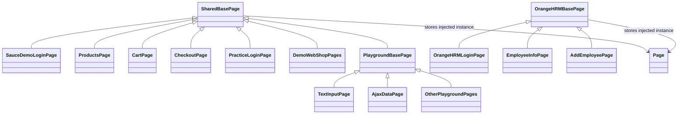
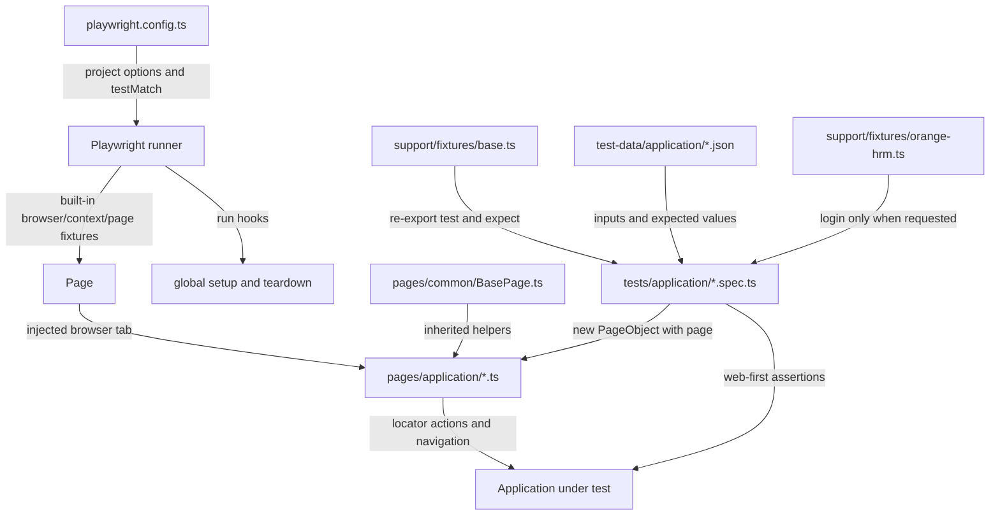
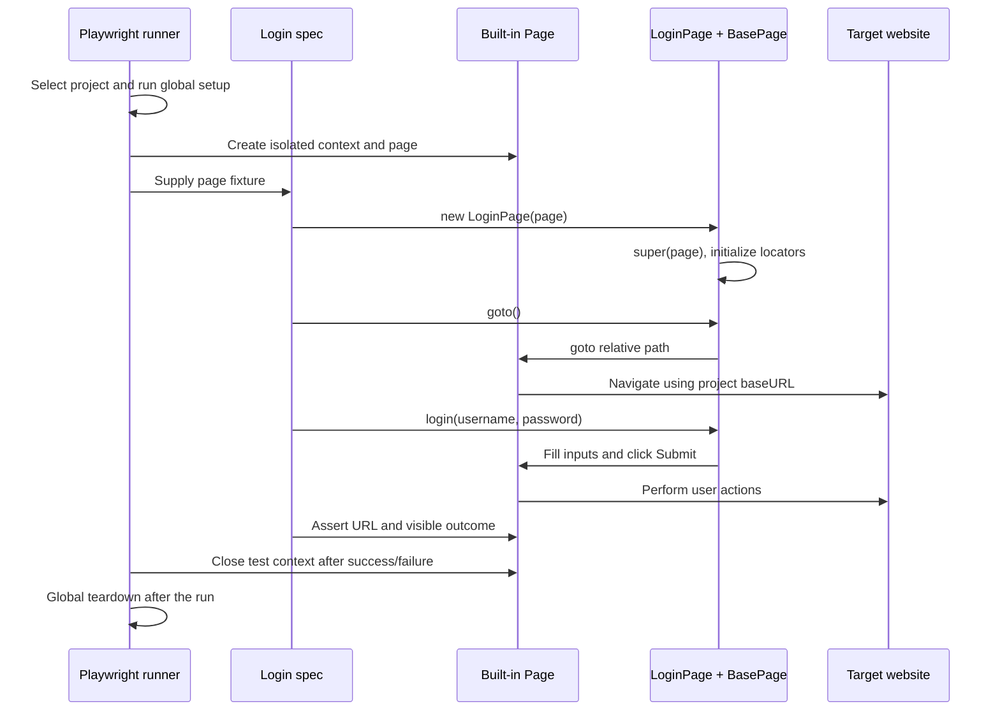

# UI Test Architecture & Conventions

Purpose

- Provide a single canonical reference for agents to create UI tests under `./ui/`.
- Enforce a consistent file structure, naming, metadata and test template so generated tests are uniform and machine-readable.

## Folder structure and responsibilities

All UI tests live under `ui/`. The current structure is:

```text
playwright.config.ts                 Projects, browsers, base URLs, test matching
playwright-global-setup.ts           Test-plan validation and delegated UI setup
ui/
├── pages/
│   ├── common/BasePage.ts           Shared TypeScript page behavior
│   ├── demo-web-shop/               Application-specific page objects
│   ├── practice-test-automation/    Login page object
│   ├── saucedemo/                   Login, products, cart, checkout pages
│   ├── ui-testing-playground/       Application base class and specialized pages
│   └── orange-hrm/                  Separate CommonJS page hierarchy
├── support/
│   ├── fixtures/
│   │   ├── base.ts                  Re-exports Playwright test, expect, Page
│   │   ├── index.ts                 Re-exports test and expect from base
│   │   └── orange-hrm.ts            Optional authenticated login fixture
│   ├── global-setup/                Run-level report/artifact cleanup
│   └── global-teardown/             Allure report generation
├── test-data/                      Suite-specific JSON inputs/expected values
├── models/                         Placeholder for future UI types
├── tests/                          Specs grouped by application, including TodoMVC
└── ui_test_architecture.md          This guide
```

| Location | Responsibility | Keep out of this layer |
| --- | --- | --- |
| [playwright.config.ts](../playwright.config.ts) | Select browser/device, host, matching specs, timeouts and reporters | Locators and business flows |
| [pages/common/BasePage.ts](./pages/common/BasePage.ts) | Store the injected `Page`; shared navigation/visibility helpers | Application-specific login or selectors |
| [pages](./pages/) | Locators and reusable user actions | Creating browsers or embedding environment hostnames |
| [support/fixtures](./support/fixtures/) | Test dependencies and reusable setup | Static test data and unrelated business assertions |
| [test-data](./test-data/) | Non-secret inputs and expected values | Live credentials or browser objects |
| [models](./models/) | Future typed UI data contracts; currently only a placeholder README | HTTP or browser lifecycle management |
| [tests](./tests/) | Scenarios, orchestration, observable outcomes and negative checks | Repeated selector implementations |
| [support/global-setup](./support/global-setup/) / [global-teardown](./support/global-teardown/) | Run-wide housekeeping and reports | Per-test login state |

There is no current `ui/selectors/` or `ui/helpers/` directory. Locators are encapsulated in page objects; executable fixtures and JSON data live in separate folders.

### Canonical SauceDemo account data

[users.json](./test-data/saucedemo/users.json) is the single account dataset. [users.ts](./test-data/saucedemo/users.ts) validates it and exports an immutable ordered array plus `usersByKey` for typed lookup. The duplicate `saucedemo_users.json` has been removed; all 17 data-consuming specs use the typed access module.

```typescript
import users, { usersByKey } from "../../test-data/saucedemo/users";

const standard = usersByKey.standard;
// Use users when generating a scenario for each account.
```

Account identity and credentials are separate from scenario expectations. [users.spec.ts](./tests/saucedemo/users.spec.ts) owns an exhaustive typed `loginExpectations` map. The `problem` account still requires the existing success/cart checks; it does not inherit the old duplicate dataset's unused `either` value. Other expectation branches and test names remain unchanged.

For another supported account, update `USER_KEYS` and the canonical JSON, then supply the new scenario expectation where needed. Validation rejects missing/duplicate keys, duplicate usernames, unsupported keys, and empty credentials instead of silently selecting a fallback account. These values are public demo credentials; private environments must continue using environment/CI secrets.

[Offline data regressions](../api/tests/framework/saucedemo-data.spec.ts) verify account identity, keyed access, immutability, and invalid-input handling. The lowercase page-object compatibility modules remain unchanged; they are re-exports rather than duplicate page implementations.

## Inheritance, imports, and composition



Diagram labels distinguish identically named classes; `DemoWebShopPages` and `OtherPlaygroundPages` group multiple concrete classes, not actual class names.

- **Inheritance:** `class LoginPage extends BasePage` reuses common page behavior. `super(page)` initializes the inherited reference to the browser page.
- **Imports:** importing `LoginPage`, JSON data, or `test` does not establish inheritance.
- **Composition/dependency injection:** `new LoginPage(page)` gives a page object the runner-managed `Page`. Several page objects can operate on that same page within one test.
- **Fixture extension:** `baseTest.extend<LoginFixture>(...)` adds fixtures to Playwright's test object; it does not extend `BasePage`.
- The shared [TypeScript BasePage](./pages/common/BasePage.ts) is a concrete class with `goto` and `expectVisible` methods.
- The [Playground BasePage](./pages/ui-testing-playground/BasePage.ts) extends it and adds application-specific waiting/link helpers. Playground pages inherit through this intermediate class.
- The [OrangeHRM BasePage](./pages/orange-hrm/BasePage.js) is a separate CommonJS class, not a subclass of the TypeScript base. Keep existing module conventions when maintaining those pages.
- [base.ts](./support/fixtures/base.ts) currently only re-exports Playwright APIs. It does **not** instantiate page objects or perform login automatically. Most TypeScript tests instantiate their own page objects.

## Dependency and execution workflow

### How modules connect



Unlike the API framework's named configuration/client factory, UI hosts and browsers come from Playwright projects. There is no `uiConfig.ts` imported by every page. A page object's relative navigation uses its injected page's configured `baseURL`.

### Example: Practice Test Automation login



1. The selected project in [playwright.config.ts](../playwright.config.ts) determines `testMatch`, browser/device, viewport, and `baseURL`.
2. Root [global setup](../playwright-global-setup.ts) validates test plans and directly invokes the UI setup. The UI setup calls [shared cleanup](../scripts/clean-ai.js) once to archive previous Allure results and reset AI artifacts. Playwright owns cleanup of each project's configured test output directory. Even filtered standard runs invoke setup; cleanup failures stop execution.
3. A spec imports `test`/`expect` from [base.ts](./support/fixtures/base.ts), a page class, and any JSON test data.
4. Playwright provides a fresh test-scoped browser context and page. The browser itself is normally worker-scoped and reused.
5. The test constructs its page object. Constructing locators does not navigate or log in; the test must call the corresponding method.
6. The page method performs interactions. Locator actions auto-wait for relevant actionability checks; they do not prove a business outcome by themselves.
7. The test uses retrying assertions such as `toBeVisible`, `toHaveText`, and `toHaveURL` to verify the outcome.
8. Playwright tears down test-scoped fixtures and closes its context even when a test fails. Page objects do not close the built-in `Page`.
9. Reporters record results and the UI global teardown attempts Allure generation.

### Authentication and fixture lifecycle

[orange-hrm.ts](./support/fixtures/orange-hrm.ts) extends Playwright with a `login` fixture. It navigates, fills the demo credentials, submits, checks that PIM is visible, then calls `await use(credentials)`.

- A test must import this extended `test` and request `{ page, login }` to trigger it. Importing the file alone does not log in.
- `await use(value)` hands the value to the dependent test; code after it runs during teardown. Setup occurs only for fixtures actually requested or their dependencies, unless explicitly marked automatic.
- This fixture logs in on the same test-scoped page and does not configure shared storage state. Unrelated tests do not inherit its cookies.
- Its current credentials are public-demo values in the implementation; this is not the template for private environments. New authentication fixtures should require environment secrets without fallback credentials.
- Do not reuse authenticated setup in login-negative tests: those scenarios must start unauthenticated.

## Scaling the UI framework

| Requirement | Changes needed |
| --- | --- |
| New scenario on an existing page | Add a test and optional JSON case; reuse page methods |
| New control/action on an existing page | Add a locator/method to that page class and verify its outcome in a test |
| New page in an existing application | Add a page class under that application's folder; use the existing project and injected `Page` |
| Shared application behavior | Add it to the application's base class only if multiple pages need it |
| New application/host | Add pages, tests/data, and a project with a narrow `testMatch` and appropriate `baseURL` |
| Additional browser | Add a project for the same suite with different device/browser settings; do not duplicate tests |
| Reusable login/page setup | Add an application fixture only where reuse warrants it; do not create global mutable page objects |
| New environment | Configure project host and credentials externally; keep hostnames out of page methods |

### A. Add a test for an existing page

This example belongs under `ui/tests/practice-test-automation/` and uses the existing page class and data. Add the metadata header described below to new specs.

```typescript
import { test, expect } from "../../support/fixtures/base";
import { LoginPage } from "../../pages/practice-test-automation/LoginPage";
import loginData from "../../test-data/practice-test-automation/login.json";

test("Invalid password keeps the user on the login page", async ({ page }) => {
  const loginPage = new LoginPage(page);
  await loginPage.goto();
  await loginPage.login(
    loginData.invalidPassword.username,
    loginData.invalidPassword.password,
  );
  await expect(loginPage.errorMessage).toHaveText(
    loginData.invalidPassword.errorMessage,
  );
  await expect(loginPage.submitButton).toBeVisible();
});
```

### B. Add a new page to an existing application

1. Create its page class in the application's `pages/` folder, extending the shared or application-specific base.
2. Accept `Page` through the constructor and call `super(page)` when defining a constructor.
3. Define stable locators and narrowly scoped interaction methods. Keep business expectations visible in tests; reusable page-level assertion helpers are also supported.
4. Construct the class with the existing test's `{ page }`. Navigating across several page objects does not require new browser contexts.
5. Add positive and negative scenarios under the existing suite. No project changes are needed if its `testMatch` already includes the new file.

### C. Add a new application

The following Orders application is **illustrative**, not an existing deployed feature. Replace paths, accessible names, and expectations with the actual application's contract.

**1. Create `ui/pages/orders/OrdersPage.ts`:**

```typescript
import { Locator, Page } from "@playwright/test";
import { BasePage } from "../common/BasePage";

export class OrdersPage extends BasePage {
  readonly heading: Locator;

  constructor(page: Page) {
    super(page);
    this.heading = page.getByRole("heading", { name: "Orders", exact: true });
  }

  async goto(): Promise<void> {
    await super.goto("./orders");
  }
}
```

**2. Add a project** to the existing `projects` array in [playwright.config.ts](../playwright.config.ts), reusing its imported `devices`:

```typescript
{
  name: "orders-chromium",
  testMatch: "**/ui/tests/orders/**/*.spec.ts",
  use: {
    ...devices["Desktop Chrome"],
    baseURL: process.env.ORDERS_UI_BASE_URL || "http://localhost:3000/",
    viewport: { width: 1280, height: 720 },
  },
},
```

This example assumes an already-running local app when no environment override is supplied. Configure a Playwright `webServer` separately if the suite must start it. Environment variables from a file require explicit loading; the root config currently does not enable its commented dotenv loader. Do not rely on API test imports to load UI settings.

**3. Create `ui/tests/orders/orders.spec.ts`:**

```typescript
import { test, expect } from "../../support/fixtures/base";
import { OrdersPage } from "../../pages/orders/OrdersPage";

test("Orders page is accessible", async ({ page }) => {
  const orders = new OrdersPage(page);
  await orders.goto();
  await expect(orders.heading).toBeVisible();
  await expect(page).toHaveURL(/\/orders\/?$/);
});
```

Add application data in `ui/test-data/orders/` and metadata to the spec. A page heading is only a smoke check; add business assertions for real order operations and explicit cleanup for data created by tests.

**4. Optionally inject the page object with a fixture.** If multiple tests need the same setup, create `ui/support/fixtures/orders.ts`:

```typescript
import { test as base, expect } from "./base";
import { OrdersPage } from "../../pages/orders/OrdersPage";

type OrdersFixtures = { ordersPage: OrdersPage };

export const test = base.extend<OrdersFixtures>({
  ordersPage: async ({ page }, use) => {
    await use(new OrdersPage(page));
  },
});
export { expect };
```

Tests then import `test`/`expect` from this application fixture and request `{ ordersPage }`. This fixture only constructs the page object; tests still call `ordersPage.goto()`. Do not call `page.close()` here because Playwright owns the built-in page lifecycle. Use `try/finally` to release resources that a custom fixture itself creates.

**5. Discover, then run the suite:**

```powershell
$env:ORDERS_UI_BASE_URL = 'http://localhost:3000/'
npx playwright test --config=playwright.config.ts --project=orders-chromium --list
npx playwright test --config=playwright.config.ts --project=orders-chromium
```

`--list` checks discovery without running the tests. A normal run invokes the configured global hooks. For an existing example, use `--project=practice-test-automation-chromium` instead; the Orders project exists only after implementing the illustrative steps above.

### Navigation and isolation guardrails

- Relative navigation resolves against the project's `baseURL`. `"/orders"` starts at the origin root, while `"./orders"` preserves a directory prefix when the base URL ends with `/`. Choose deliberately for applications hosted under subpaths.
- Existing [Practice LoginPage](./pages/practice-test-automation/LoginPage.ts) calls `super.goto(".")` to retain its configured login directory; [SauceDemo LoginPage](./pages/saucedemo/LoginPage.ts) uses the root `/`.
- UI project routing is not the API named-target mechanism. Do not import `API_CONFIG` into a UI page to choose its website.
- Keep page objects and mutable data test-local. Never share a `Page` between parallel tests or depend on one test logging in for another.
- Preserve assertion intent when fixing failures. Diagnose selectors, readiness, state, and application defects rather than dropping checks or broadening expected outcomes.
- Browser isolation does not undo server-side changes. Tests creating users/orders/employees need explicit, reliable backend or UI cleanup.

File naming conventions

- Use kebab-case for files and folders.
- Prefix test files with date (YYYYMMDD) when the test is created by an agent, then a concise title: `20261001-login-flow.spec.ts`.
- Test file extension: `.spec.ts` (Playwright TypeScript). If using another stack, keep the same convention but adjust extension.

Test metadata header (top of each test file)

- Every generated test file must start with a JSON metadata block in a single-line comment or a JS/TS block comment to allow parsing by agents and tools. Example:

/*
{
"id": "ui-login-001",
"suite": "auth",
"title": "Login with valid credentials",
"priority": "P1",
"tags": ["smoke","auth"],
"author": "agent/<agent-name>",
"created": "2026-10-01"
}
*/

- Required fields: `id`, `suite`, `title`, `priority`, `tags`.
- Optional: `owner`, `description`, `relatedTicket`.

Test template (Playwright TypeScript)

- Every test must follow this scaffold so tools and reporters can parse intent.

Use the runnable-pattern example in [Add a test for an existing page](#a-add-a-test-for-an-existing-page): import the suite's test fixture, construct or request its page object, load non-secret data, perform actions, and assert observable results. Group multi-step scenarios with `test.step` as in the existing Practice Test Automation tests. For private accounts, require credentials from environment/CI secrets and fail clearly if missing; never silently substitute sample credentials.

Selectors and page objects

- Prefer role/name, label, or stable test-ID locators. Use scoped CSS only when a stable accessible locator is unavailable; avoid positional selectors and fragile DOM chains.
- Centralize reusable locators in [page objects](./pages/), not in a new parallel selector hierarchy.

Test data and fixtures

- Keep static JSON test data in [ui/test-data](./test-data/) and executable setup in [ui/support/fixtures](./support/fixtures/).
- Do not hardcode secrets; use environment variables for credentials when available (document in the test metadata if env-vars are required).

Retries, timeouts and flakiness

- Follow the configured test and assertion timeouts; use narrowly justified overrides rather than increasing all waits.
- Do not skip, mark fixme, remove assertions, or add retries merely to hide failures. Any quarantine requires explicit approval and a documented issue/reason.
- Prefer web-first assertions and locator auto-waiting over fixed sleeps. Wait for the actual readiness signal, not arbitrary time.

Reporting and attachments

- Follow [project reporter configuration](../playwright.config.ts). It currently enables traces on the first retry; a failure with no retry does not automatically produce that trace.
- Configure `screenshot: "only-on-failure"` when screenshots are required; the root config does not currently enable automatic failure screenshots. Attach relevant diagnostics without exposing secrets.
- Root setup uses shared cleanup to archive previous Allure results (default retention: 3, configurable through `ALLURE_KEEP_RUNS`) and reset AI failure artifacts. Playwright cleans configured test output directories; global teardown still attempts Allure generation. Avoid concurrent runs that share report directories. See [cleanup ownership](../ai/failure-summaries/README.md#cleanup-ownership-and-retention).

Code style and linting

- Follow repo conventions: TypeScript, Prettier formatting, ESLint rules. Add imports at top and avoid inline helper duplication.

PR checklist for generated tests

- Metadata block is present and correct.
- Locators are stable and reusable actions live in the application's page objects.
- No secrets hardcoded.
- Test passes locally (agent unit-run) and does not modify production data.

Generator guidelines for agents (how to use this file)

- Always create the metadata JSON block first.
- Place the test in `ui/tests/<suite>/` and name it following the naming convention.
- Reuse the application's page objects; add locators/methods there for new actions.
- Add non-secret static data under `ui/test-data/<suite>/`; add executable fixtures under `ui/support/fixtures/` only when setup needs reuse.
- Run the test locally (playwright test <file>) and capture the result. If failing due to timing, add targeted waits rather than global sleeps.

Reference implementations

- [Practice successful login](./tests/practice-test-automation/successful-login.spec.ts): page construction, JSON inputs, `test.step`, and outcome assertions.
- [Practice invalid password](./tests/practice-test-automation/invalid-password.spec.ts): negative behavior with an explicit error and URL assertion.
- [OrangeHRM test](./tests/orange-hrm/add-delete-employee.spec.js): consumes the custom `login` fixture and multiple page objects on one page. This is a wiring example, not a complete assertion/cleanup template; add those explicitly for new CRUD scenarios.

---

If you need the generator to follow additional rules (naming prefixes, custom metadata fields, or a different test runner), update this file and notify agents.
